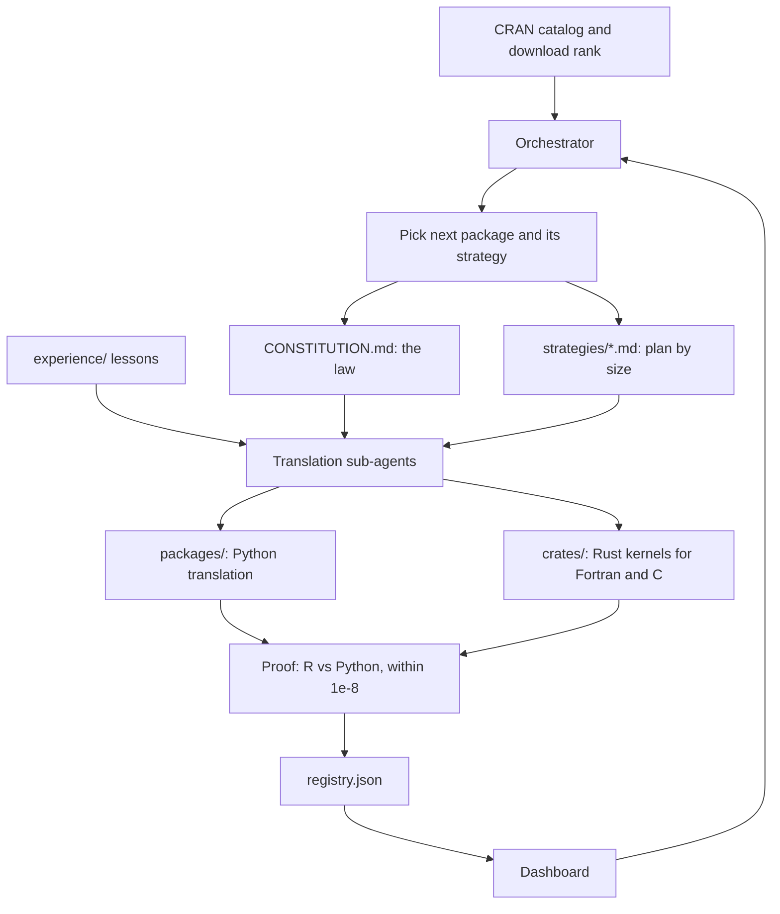

# How killr works

killr turns an R package into a Python package, and a compiled kernel into a Rust crate, and proves each function against R. This page explains the moving parts and how they connect.

## The flow

## The parts

**Orchestrator** ([strategies/orchestrator.md](../strategies/orchestrator.md)). It decides what runs next. It orders packages by their dependencies and by the CRAN download ranking, and it caps how many run at once. A small package can run beside other work. A large package does not share the session with another large one. It also chooses the model for each batch and records every finished batch on the dashboard.

**Constitution** ([CONSTITUTION.md](../CONSTITUTION.md)). The rules every agent follows: what counts as translated, the order of work, the routing to stand-ins (for example Polars for data frames, Matplotlib for charts, NumPy for vectors), the proof, and the rule that Fortran and C kernels go into Rust crates.

**Strategies** ([strategies/](../strategies/)). One plan per package size:

| Strategy | When it applies |
| --- | --- |
| `small` | 20 functions or fewer still to translate |
| `medium` | 21 to 80 functions |
| `large` | more than 80 functions; functions are grouped into task forces |
| `huge` | more than 200 exports; a stand-in is checked before it is opened |
| `small-low`, `medium-low`, `large-low` | the same sizes, for packages with Fortran or C that computes |
| `hard-function` | one function that failed before; retried with a stronger model |

**Sub-agents.** Each translation runs as a sub-agent. It reads the constitution and its strategy, opens at most three lesson files from `experience/`, writes the Python translation, and writes the R and Python proof scripts.

**Experience** ([experience/](../experience/)). Each pitfall an agent hits becomes one short lesson, named after the pitfall. Later agents read the matching lessons before they start, so a mistake is made once.

**Proof.** The proof is the test that decides whether a function is done. The R and Python versions run on the same input, and the outputs must match within 1e-8. Each function also records its R and Python timing, so the speedup is measured, not assumed.

**Registry** ([registry.json](../registry.json)). The one record of every package, crate, and native library: status, functions translated, proof checks, and dependencies. It is generated, not edited by hand.

**Dashboard** ([dashboard/](../dashboard/)). Built from the registry by `python3 dashboard/build.py --home`. It shows progress, proof results, and cost, and it is what the pitch page embeds.

## Where things live

| Path | Holds |
| --- | --- |
| `CONSTITUTION.md`, `NATIVE.md` | The rules |
| `strategies/` | The plans, one per size, and the orchestrator |
| `experience/` | The lessons |
| `packages/<Name>/` | One translated package: Python code, proofs, outputs |
| `crates/<name>/` | One Rust kernel |
| `registry.json` | The generated record |
| `dashboard/` | The build script and pages |
