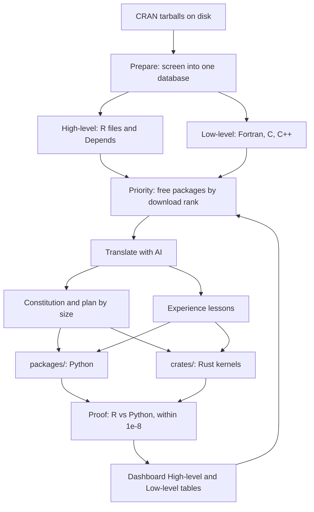

# How killr works

killr turns an R package into a Python package, and a compiled kernel into a Rust crate, and proves each function against R. The work has three steps: prepare the catalog, translate with AI, and prove every function.

## The flow

## 1. Prepare and prioritize

A prepare program reads the catalog already on disk under `rcran/contrib` and writes one SQLite database. That database is what the dashboard reads. Agents do not invent the inventory.

**Low-level.** Fortran, C, and C++ files and line counts, plus whether a Rust crate already covers the kernel. A package whose compiled code computes later gets a `*-low` plan. A thin wrap around an existing C++ system is routed, not rewritten.

**High-level.** R files, exported functions, and the packages in Depends and Imports. A package is free when those dependencies are already finished or replaced. Suggests and Enhances do not block. Base R is not opened as a package.

**Priority.** When several packages are free, the next one is the highest last-month download rank from the RStudio CRAN mirror. A dependency of a listed package is opened before that package. A package on the replaced list is a stand-in, not a translation.

The High-level and Low-level tables on the [front page](index.html) are this inventory.

## 2. Translate with AI

Each free package is handed to translation agents. They follow one constitution and the plan stored on that package. They write Python under `packages/<Name>/`, and they write Rust under `crates/<name>/` when the work is a compiled kernel. The source is the tarball on disk, not GitHub.

**Constitution** ([CONSTITUTION.md](../ai-handbook/CONSTITUTION.md)). The rules every agent follows: what counts as translated, the order of work, routing to stand-ins, wrapping versus remaking, and the Rust kernel rule. S3, S4, R6, and S7 are not copied as object systems. The translation is a Python class or a Rust struct, and the method body is an ordinary function.

**A plan by size** ([strategies/](../ai-handbook/strategies/)):

| Plan | When it applies |
| --- | --- |
| `small` | 20 functions or fewer still to translate |
| `medium` | 21 to 80 functions |
| `large` | more than 80 functions; related functions are grouped into a task force |
| `huge` | more than 200 exports; a stand-in is checked before the package is opened |
| `small-low`, `medium-low`, `large-low` | the same sizes, when the tarball has Fortran or C that computes |
| `hard-function` | one function that already failed; retried once with a stronger model |

**Routing.** Some R packages are a thin wrap around a system that already exists. Those are recorded as replaced and are not translated. Data frames go to Polars, charts to Matplotlib or one killplot function, HTTP to requests, XML and HTML to libxml2, vectors to NumPy. A new big library is named and agreed before it is used.

**Wrapping or remaking.** When R only wraps a C++ system, Python or Rust wraps that same system. The R glue is not translated. When the algorithm is original to R, including a kernel written in C++ or Fortran, the algorithm is remade. That kernel lives in its own crate and is loaded, not ported again.

**Experience** ([experience/](../ai-handbook/experience/)). Each pitfall becomes one short lesson file, named after the fact. Later agents open at most three matching files before they start, so a mistake is written down once.

**How a batch runs.** Easier first-pass Python uses a faster model. Work that already has a matching lesson, a new crate, or a failed proof uses a stronger thinking model. A batch returns three things: the proof, any packages it is waiting on, and at most one new lesson. If a function calls another package that is not yet translated, it is marked waiting and the next package opened is one of those names.

How many packages may be open at once, and which model a batch uses, is [strategies/orchestrator.md](../ai-handbook/strategies/orchestrator.md).

## 3. Proof against R

A function is finished only when the proof matches.

- The R and Python versions run on the same input.
- The outputs must agree within `1e-8`. The proof compares values, not object-system dispatch.
- One untimed call, then the median of 20. R uses `Sys.time()`. Python uses `time.perf_counter()`. Speedup is the R time divided by the Python time.
- The two scripts live under `packages/<Name>/proof`. What they print or draw is saved under `packages/<Name>/docs/output/`. A `.txt` file is shown as text. An `.svg` file is shown as the figure.
- A function whose note begins with `Left` is reserved, not claimed.

## Where things live

| Path | Holds |
| --- | --- |
| `orchestrator/` | Prepare, screen, ingest, batch, and the dashboard rebuild |
| `orchestrator/orchestrator.sqlite` | The one database the dashboard reads |
| `ai-handbook/CONSTITUTION.md`, `NATIVE.md` | The rules |
| `ai-handbook/strategies/` | The plans, one per size |
| `ai-handbook/experience/` | The lessons |
| `packages/<Name>/` | One translated package: Python code, proofs, outputs |
| `crates/<name>/` | One Rust kernel |
| `rcran/` | Tarballs, catalog, download rank, replaced list |
| `docs/` | The one public dashboard |
